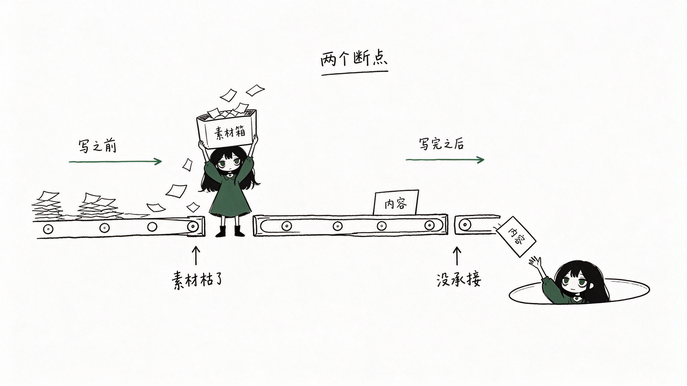
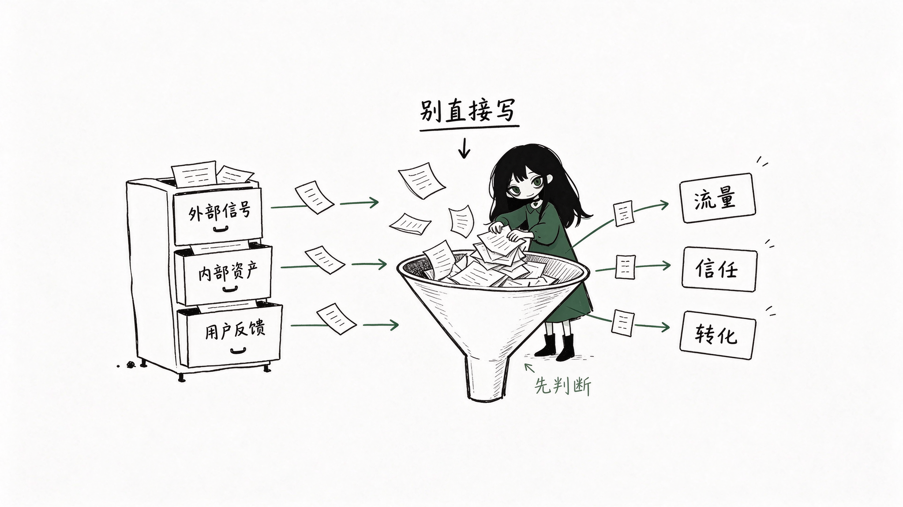
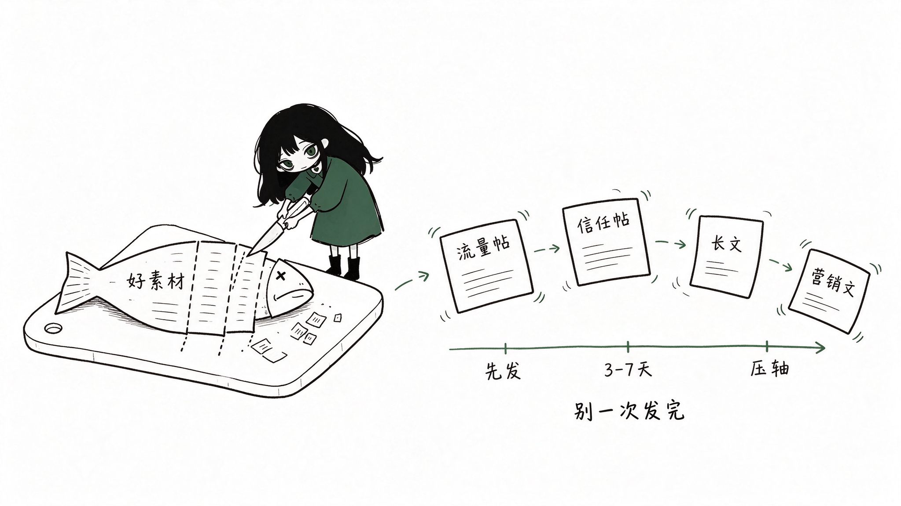
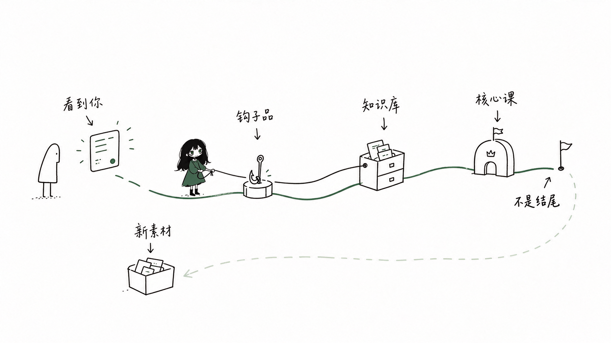
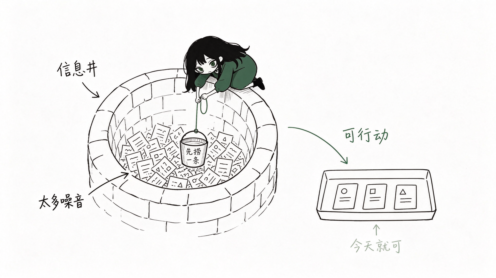
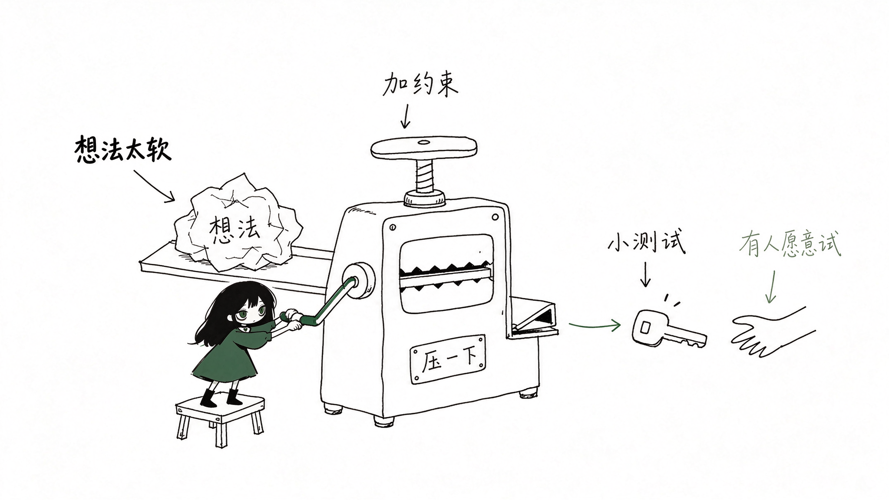
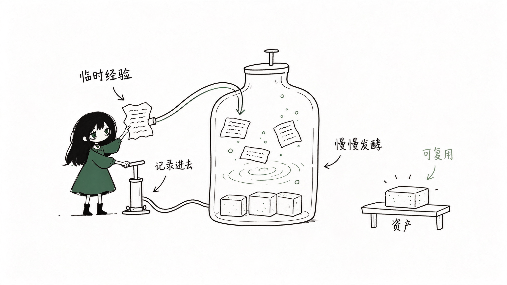
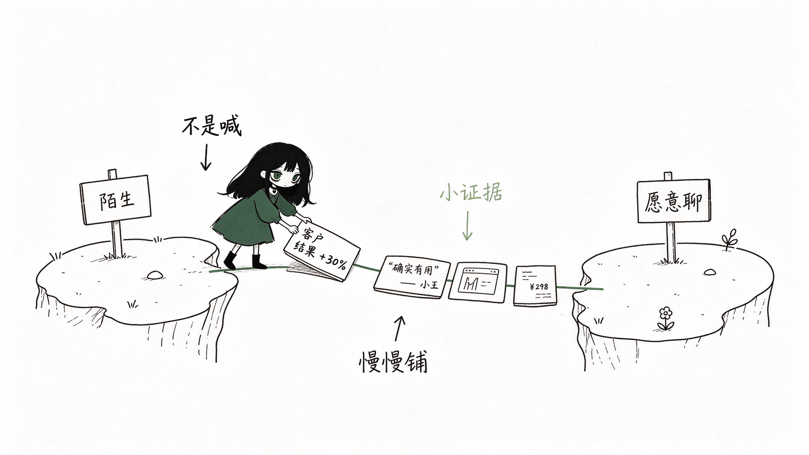

# Tuotuo Illustrations

> 把中文文章里的判断、流程、状态和隐喻，变成一张张白底、手绘、怪诞但清爽的正文配图。
>
> 16:9 横版 | 托托 IP | 纯白手绘 | 黑 + 墨绿双色 | Codex Skill

---

## 这个仓库是什么？

Tuotuo Illustrations 是一个 Codex Skill，用来指导 AI Agent 为中文文章、帖子、博客、Notion 文档和方法论内容生成正文配图。

它不是通用插画 prompt，也不是 PPT 信息图模板。它的核心目标是：先理解文章里的认知锚点，再把其中一个判断、流程、结构、状态或隐喻，变成一张有记忆点的 16:9 手绘解释图。

本项目衍生自 Ian 的 [Ian Xiaohei Illustrations](https://github.com/helloianneo/ian-xiaohei-illustrations)（MIT），沿用了它的技能结构、工作流和提示词工程，只把固定视觉 IP 从“小黑”换成了作者自己的角色“托托”，并把原来的红橙蓝批注体系收拢成黑 + 墨绿双色。署名与授权见 [NOTICE.md](NOTICE.md)。

默认视觉 IP 是“托托”：一个黑色浓密长发、墨绿连衣裙、黑短靴的简笔少女，表情平静到近乎空，认真做一件荒诞但成立的体力活。她不是吉祥物，不是贴纸，也不是站在角落里的装饰物，而是正在认真参与系统运转的工人。身边可选的搭档是黑猫 mia。

一句话：**让 AI 不只是“配一张图”，而是把文章里的一个关键认知动作画出来。**

---

## 适合谁用

特别适合：

- 写中文文章，需要正文配图和文章插图的人
- 做知识型内容、方法论内容、AI 工作流内容的人
- 想把抽象判断画成具体隐喻的人
- 想要一种比 PPT 信息图更轻、更怪、更有个人识别度的配图风格的人
- 用 Codex 做内容生产，希望稳定复用一套视觉语言的人

不适合：

- 想要商业插画、品牌 KV 或精致扁平插画的人
- 想要传统 PPT 信息图、复杂架构图或流程图的人
- 想要儿童卡通、可爱 IP、表情包风格的人
- 想把大量正文、长段解释或完整课程页塞进一张图里的人
- 需要严格可编辑矢量源文件的人

---

## 它会产出什么

默认输出：

- 16:9 横版正文配图
- 一篇文章的 4-8 张 shot list
- 每张图的主题、核心意思、结构类型、托托动作和中文标注建议
- 最终 PNG 图片，保存到 workspace 的 `assets/<article-slug>-illustrations/`

默认不输出：

- PPTX / PDF / Keynote
- SVG / HTML / Canvas 可编辑图
- 商业海报或封面 KV
- 大段文字型信息图

---

## 视觉风格

- 纯白背景，不要纸纹、米色、阴影、渐变
- 黑色手绘线稿，细线，轻微抖动，平涂
- 只用两种颜色：黑 + 墨绿
- 大量留白，主体只占画面约 40%-60%
- 少量中文手写批注，最多 5-8 处，每处 2-8 个字
- 一张图只表达一个核心动作、结构、状态或隐喻
- 托托必须参与核心动作，不能只是装饰
- 怪诞、有创意、清爽，但不幼稚、不卖萌

墨绿承担裙子、主流程、箭头和关键强调；原来靠红色标重点的地方，现在用黑色加粗、实心块、双线或叉号表达。

---

## 示例效果

以下样例均为托托版，用于校准形象、线条密度和双色克制。构图只作参考，实际配图应从当前文章重新发明隐喻。

### 两个断点



### 按目的分拣



### 一鱼多吃



### 承接路径



### 信息井



### 想法压机



### 内容发酵



### 信任桥



托托的形象基准见 `tuotuo-illustrations/assets/ip/tuotuo-mia.png`。

---

## 安装

克隆仓库：

```bash
git clone https://github.com/tding1006/ian-xiaohei-illustrations.git
cd ian-xiaohei-illustrations
```

复制 skill 到 Codex skills 目录：

```bash
mkdir -p "${CODEX_HOME:-$HOME/.codex}/skills"
cp -R ./tuotuo-illustrations "${CODEX_HOME:-$HOME/.codex}/skills/"
```

安装后，在 Codex 里使用：

```text
Use $tuotuo-illustrations 为这篇中文文章设计并生成 5 张托托怪诞正文配图。
```

---

## 怎么用

### 只做配图规划

```text
Use $tuotuo-illustrations 先不要生图。
请分析下面这篇文章哪里值得配图，输出 5 张左右的 shot list。
每张图写清楚：放在哪段后、主题、核心意思、结构类型、托托在做什么、建议中文标注词。

<粘贴文章>
```

### 直接生成正文配图

```text
Use $tuotuo-illustrations 把下面这篇文章生成 4 张托托怪诞正文配图。
要求：16:9 横版、纯白背景、黑色手绘线稿、只有黑和墨绿两种颜色。

<粘贴文章>
```

### 为单个概念生成一张图

```text
Use $tuotuo-illustrations 为“信任不是喊出来的，而是一块证据一块证据铺过去”生成一张正文配图。
画面要怪诞但清爽，托托必须承担核心动作。
```

### 去掉图里的标题或错误文字

```text
Use $tuotuo-illustrations 帮我编辑这张图，去掉左上角的“流程图”标题，其他内容保持不变。
```

更多示例见 [examples/prompts.md](examples/prompts.md)。

---

## 工作流程

这个 skill 的流程是：

1. 读取文章、Markdown、Notion 内容、截图或用户给的主题
2. 提炼核心观点、认知转折、流程结构和适合视觉化的段落
3. 先输出 shot list：每张图只选一个认知锚点
4. 为每张图选择结构类型：Workflow、系统局部、前后对比、角色状态、概念隐喻、方法分层、地图路线或小漫画分镜
5. 重新发明一个低科技、怪诞但成立的物理隐喻
6. 让托托承担核心动作
7. 每张图单独调用图像模型生成，能传参考图时传入形象基准图
8. 按 QA checklist 检查：白底、留白、托托动作、双色克制、中文标注、非 PPT 感、非旧案例复刻
9. 保存最终 PNG，并报告用途和路径

---

## 目录结构

```text
.
├── README.md
├── LICENSE
├── NOTICE.md
├── assets/
│   └── ian-wechat-qr.jpg      # 原作者个人二维码，公开 fork 前建议删除
├── examples/
│   ├── images/                # 8 张托托版样例，README 展示用
│   └── prompts.md
├── legacy/
│   └── xiaohei-examples/      # 原作者的小黑样例，仅归档，不进安装目录
└── tuotuo-illustrations/
    ├── SKILL.md
    ├── agents/
    │   └── openai.yaml
    ├── assets/
    │   ├── ip/
    │   │   └── tuotuo-mia.png # 托托与 mia 形象基准图
    │   └── examples/          # 14 张托托版样例，仅作风格校准
    └── references/
        ├── tuotuo-ip.md
        ├── style-dna.md
        ├── composition-patterns.md
        ├── prompt-template.md
        └── qa-checklist.md
```

真正需要安装到 Codex 的是子目录：

```text
tuotuo-illustrations/
```

根目录的 README、LICENSE、NOTICE 和 examples 是 GitHub 分享文档。

---

## 注意事项

- 图片里的中文文字越短越稳定。
- 每张图只讲一个核心结构，不要把文章做成说明书。
- 托托必须承担核心动作；如果去掉托托画面仍然完全成立，说明她太装饰了。
- 托托是人形角色，不能变成漏斗、黑块、影子；荒诞感要靠物件和动作。
- 示例图只用于校准托托形象、线条密度、留白和双色克制，不要复刻构图。
- AI 图像模型可能出现错字、幻觉标签、风格漂移或多余标题，生成后需要检查。
- 托托最常见的漂移是“变可爱”，出现腮红、闪亮眼、换装时要立刻重生成。
- 如果中文错字严重，优先减少标注词并重生成。

---

## 相关项目

- [Ian Xiaohei Illustrations](https://github.com/helloianneo/ian-xiaohei-illustrations) — 本项目上游，小黑怪诞正文配图 Skill
- [Ian Handdrawn PPT](https://github.com/helloianneo/ian-handdrawn-ppt) — 中文手绘技术 PPT-style 页面图生成 Skill

---

## License

MIT License. See [LICENSE](LICENSE). 原作者 Ian 的署名要求见 [NOTICE.md](NOTICE.md)。
